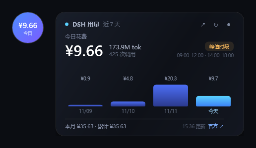

# DSH 用量悬浮球

> 贴在 DeepSeek Harness 窗口里的一个用量小球：点开看今天 / 本月花了多少钱、用了多少 token，按官方人民币峰谷价估算。

> **非官方项目**：与 DeepSeek 官方无关，不代表官方立场。数据只读本机会话日志，费用为估算，官方账单请以 [platform.deepseek.com/usage](https://platform.deepseek.com/usage) 为准。

## 它解决什么问题

DSH 自带的 token 统计是**单会话**的，也没法直接折成钱；官方控制台又要点开网页、等数据同步。

这个小球常驻在 DSH 窗口右下角：

- 收起时只有 64px，显示**今日花费**
- 点开看：今日花费 / token / 调用次数、近 7 天柱状图、本月与累计
- 按**官方人民币价目表**折算，区分**高峰 / 空闲**时段
- 右上 `↗` 或底部「官方 ↗」一键打开官方用量页对账

## 特性

- **只贴在 DSH 窗口里**：跟随窗口移动/缩放，DSH 最小化或被别的软件盖住时一起隐藏，不会浮在别的软件上面
- **按天看**：近 7 天柱状图 + 本月 / 累计
- **折算成钱**：缓存命中 / 未命中 / 输出三档单价，按每次调用的时间判断峰谷
- **小球形态**：默认收起，点一下展开；`●` 收回
- **任意位置拖动**：在小球或卡片任意位置按住即可平移
- **边缘缩放**：鼠标靠近卡片四边/四角自动变成双向箭头，拖动缩放（0.8×–1.8×）
- **只读、本地**：不写会话、不联网上报、不申请任何提权

## 安装

1. 到 [Releases](https://github.com/haym35071-afk/dsh-usage-ball/releases) 下载 `DSH-Usage-Ball-Installer.cmd`
2. 双击运行
3. 自动安装到 `%LOCALAPPDATA%\DshUsageBall`，创建桌面 / 开始菜单快捷方式，并启动小球
4. 小球出现在 DSH 窗口右下角

> 首次运行 Windows 可能提示「Windows 已保护你的电脑」——点「更多信息 → 仍要运行」。安装包未签名，这是常规提示。

**环境要求**：Windows 10/11 + 已安装 DeepSeek Harness 桌面版。不需要另装 Node（脚本会自动找 DSH 自带的运行时）。

**卸载**：右键小球 →「退出悬浮窗」，删除 `%LOCALAPPDATA%\DshUsageBall` 和快捷方式。

## 数据与计价

- 数据来源：`%USERPROFILE%\.dsh\sessions` 下的会话日志（JSONL + zstd），只读
- 计价单位：元 / 百万 tokens

| 模型 | 缓存命中（峰/谷） | 缓存未命中（峰/谷） | 输出（峰/谷） |
| --- | --- | --- | --- |
| deepseek-flash | 0.04 / 0.02 | 2 / 1 | 8 / 4 |
| deepseek-v4-pro | 0.30 / 0.15 | 9 / 4.5 | 27 / 13.5 |

- 高峰：北京时间周一至周五 09:00–12:00、14:00–18:00（不含法定节假日）
- 其余时段（含周末、节假日）为谷时，价格是高峰的一半
- 费用 = 未命中输入 × 未命中价 +（缓存读取 + 缓存写入）× 命中价 + 输出 × 输出价

价格来源：[DeepSeek 模型 & 价格（中文）](https://api-docs.deepseek.com/zh-cn/quick_start/pricing)

## 已知限制

- 是**估算**，不是账单；官方控制台为准
- 只统计本机会话日志；换机器、网页版、其他客户端的用量不在这里
- 会话标题生成、上下文压缩等内部调用如果没写进日志 usage，就不会被计入
- 峰谷按调用**记录时间**判断，与官方按请求发起时间判断可能有几分钟边界差

## 反馈

- [提交 Issue](https://github.com/haym35071-afk/dsh-usage-ball/issues/new/choose)（Bug / 功能建议 / 安装问题）
- 反馈时请附上：Windows 版本、DSH 版本、`%LOCALAPPDATA%\DshUsageBall\widget.log` 最后 20 行
- 欢迎在 Issue 里说“你最想要的一个功能”，我会按呼声排期

## Roadmap

- [ ] 应用内一键复制诊断信息
- [ ] 历史明细（按天 / 按模型 / 按会话）
- [ ] 预算与超支提醒
- [ ] 导出 CSV / 长图
- [ ] 自动更新
- [ ] 多账号 / 团队看板（Pro）

## 开发

`src/` 是全部源码，无构建步骤：

| 文件 | 作用 |
| --- | --- |
| `widget.ps1` | WPF 悬浮球 / 卡片（无边框、透明、跟随 DSH 窗口） |
| `collect.mjs` | 扫描会话日志，聚合成 `state.json` |
| `bootstrap.ps1` / `install.cmd` | 安装器逻辑 |
| `start.vbs` | 静默启动 |

本地调试：`powershell -Sta -File widget.ps1 -Preview` 只渲染预览图，不显示窗口。

## License

[MIT](LICENSE)
